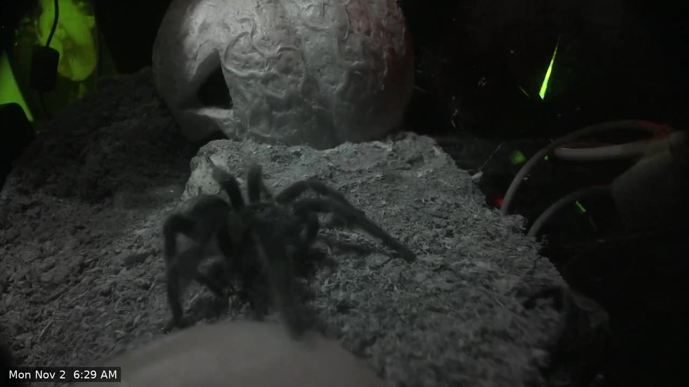

# creeperCam

Night-vision cameras for pet enclosures: a Raspberry Pi, a Camera Module 3 Wide NoIR, 3D-printed pods,
Frigate for recording and Home Assistant for dashboards. A nightly job turns the day's recordings into a
short highlight reel of the moments the animal is in view. This repository is the whole project: CAD,
software, and a full write-up.

*A frame from a generated highlight reel. Night view with continuous autofocus, lit by an 850 nm IR strip.*

## Status

| Piece | State |
|---|---|
| Camera and Pi streaming 1080p at 15 fps | Working (one camera live) |
| Frigate recording and Home Assistant dashboard | Working |
| IR light | Working (12 V 850 nm strip on a Shelly dimmer, controlled from Home Assistant) |
| Nightly highlight reel | Working |
| Printed pod v5 | Designed; earlier versions test-printed; final fit check open |
| Self-contained box | Draft, not printed |

## Read the write-up

Start at [`docs/index.md`](docs/index.md). The same pages are built as a site from `docs/`.

| Page | Contents |
|---|---|
| [Hardware](docs/hardware.md) | Parts, design decisions, camera measurements |
| [Enclosures and printed parts](docs/enclosures-and-stls.md) | Every STL, dimensions, design history |
| [Software](docs/software.md) | Pi setup, mediamtx config, web UI, autofocus tuning |
| [Home Assistant and Frigate](docs/home-assistant-frigate.md) | Recording, dashboard, saving clips |
| [Highlight reels](docs/highlight-reels.md) | The nightly job that finds the animal and cuts a reel |
| [IR light](docs/ir-light.md) | The 850 nm illuminator |
| [Build guide](docs/build-guide.md) | Step-by-step replication |
| [Parts list](docs/bom.md) | What to buy |
| [Lessons learned](docs/lessons-learned.md) | What went wrong |
| [Gallery](docs/gallery.md) | Stills from the camera and from reels |

## Repository layout

| Path | What |
|---|---|
| `pod.scad` | Parametric OpenSCAD source for the pod |
| `body-v5.stl`, `body-v5-flat.stl`, `cap-v5.stl`, `assembly.stl` | Current print-ready parts |
| `reels/` | Highlight reel tool: `digest.py`, `scorer.py`, `nightly.py` |
| `ir/` | IR driver docs, MQTT service, and the self-contained box (SCAD and STL) |
| `webui/` | Flask camera control UI |
| `pi-setup.sh` | Pi setup script |
| `BOM.md`, `BOM-test.md` | Full parts lists with store links |
| `docs/` | The write-up and its images |

Older STL versions and `pod.scad.bak*` files are design history.

## Safety

Never use acetone, solvent glue or isopropyl-heavy cleaner on acrylic enclosures. Keep magnets 30 mm
or more from the camera lens: the autofocus is a voice coil.
