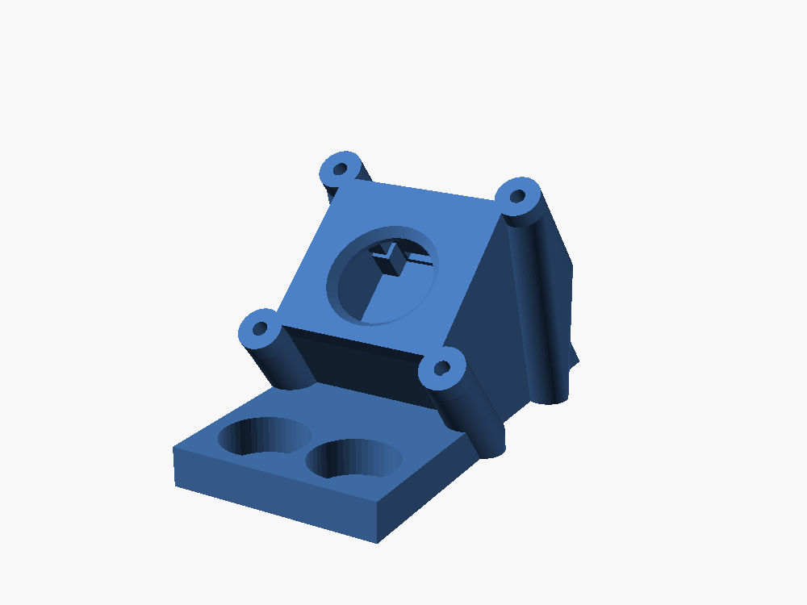
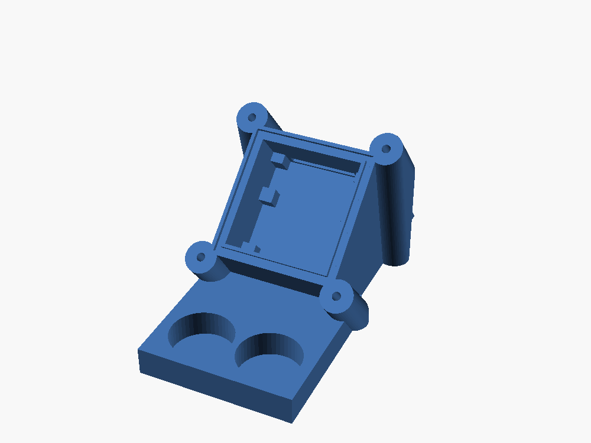
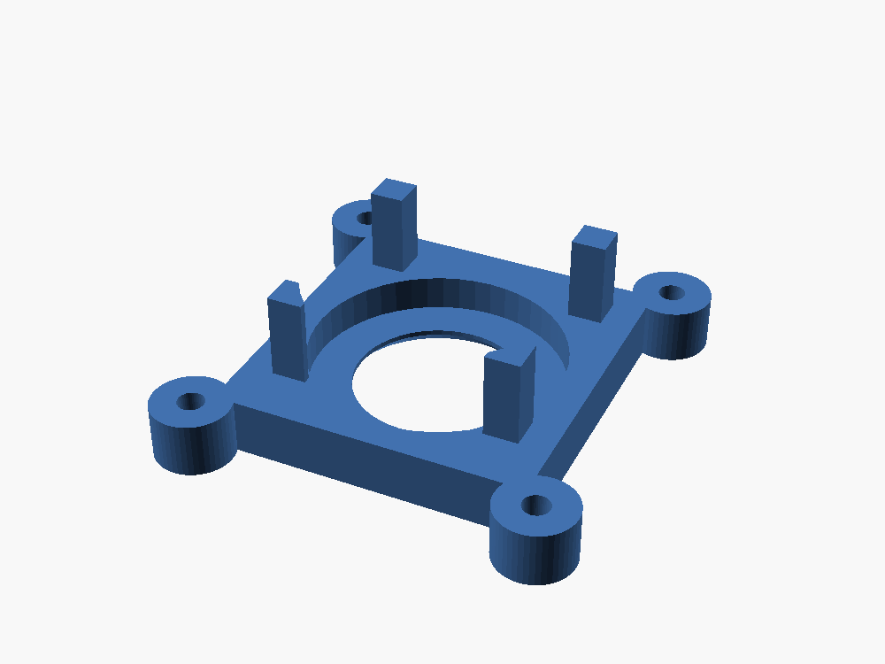
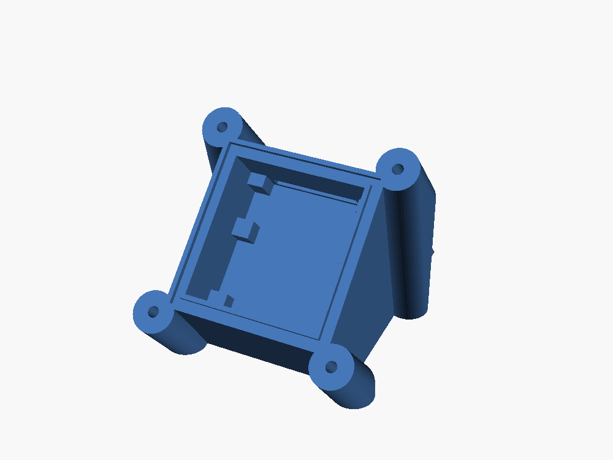
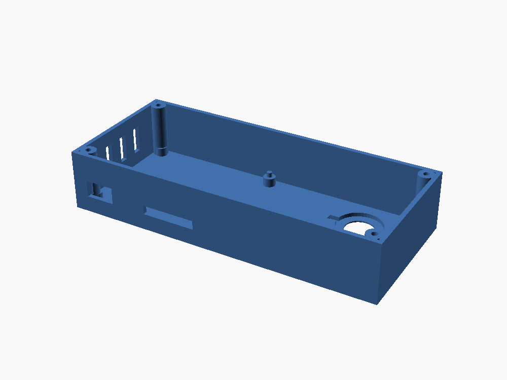
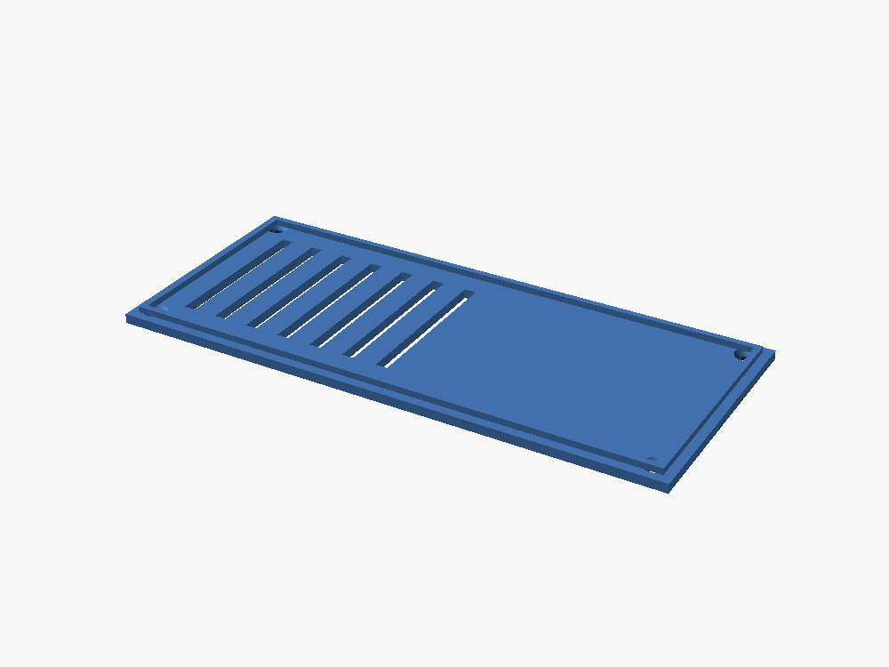

# Enclosures and printed parts

Every printed part, its dimensions, the OpenSCAD parameters that shape it, and how the design evolved.

Everything is parametric OpenSCAD (`pod.scad` for the pod, `ir/creepcam-box.scad` for the box). The STL
files are the rendered, print-ready results. Download links point at the [repository]({{ site.github.repository_url }}).

## Current files

| File | What it is | Size (mm) |
|---|---|---|
| [`body-v5.stl`]({{ site.github.repository_url }}/blob/main/body-v5.stl) | Pod body with the magnet plate (the main part) | 42.8 x 85.0 x 40.8 |
| [`body-v5-flat.stl`]({{ site.github.repository_url }}/blob/main/body-v5-flat.stl) | Same body with no magnet plate, for Command Strips or tape | 42.8 x 61.1 x 40.8 |
| [`cap-v5.stl`]({{ site.github.repository_url }}/blob/main/cap-v5.stl) | Front cap: glass window seat and four PCB-clamping pegs | 42.8 x 44.4 x 14.2 |
| [`assembly.stl`]({{ site.github.repository_url }}/blob/main/assembly.stl) | Pod assembled, for viewing only | 42.9 x 81.5 x 44.2 |
| [`ir/creepcam-body.stl`]({{ site.github.repository_url }}/blob/main/ir/creepcam-body.stl) | Self-contained box: Pi + perfboard + IR LEDs | 140.2 x 61.2 x 26.8 |
| [`ir/creepcam-lid.stl`]({{ site.github.repository_url }}/blob/main/ir/creepcam-lid.stl) | Lid for the box | 140.2 x 61.2 x 4.0 |

Older versions (`body.stl`, `body-v2` to `-v4`, `cap.stl`, `cap-v2`, `cap-v3`) are kept in the repository as history.

## The pod



The pod is a wedge that sits on the inside of the enclosure wall and tips the lens 40 degrees down. The camera
board drops onto four posts, four pegs on the cap pin its corners, and the cap closes against a
silicone gasket. A glass tile covers the lens. The ribbon leaves through a slot in the top edge, and
the slot is sealed with silicone.



*Body v5: PCB seat, top stops, ribbon slot, and the two magnet pockets on the base plate.*



*Cap v5 (upside down for printing).*



*Flat variant: no magnet plate; the wedge footprint is the contact area (31.8 x 46.6 mm).*

### Key parameters (`pod.scad`)

| Parameter | Value | Notes |
|---|---|---|
| `tilt` | 40 | Lens pitch down from the wall normal. Up to 45 prints without supports. |
| `mount` | `"magnet"` | `"flat"` leaves out the plate and pockets. |
| `exit_side` | `"top"` | Edge the ribbon leaves from. |
| `cam_w`, `cam_d` | 24.93, 24.12 | Clone PCB, measured. |
| `cam_total` | 8.33 | PCB back to lens front (7.21 lens + 1.12 PCB). |
| `lens_dy` | 2.25 | Lens toward the ribbon-connector edge. |
| `disc_d`, `disc_t` | 25.6, 3.5 | Glass tile seat and thickness. |
| `win_d` | 17 | Clear aperture (wide enough for 120 deg at the window gap). |
| `mag_d`, `mag_t` | 15, 5 | Magnet disc; match what you buy. |
| `mag_extra` | 9 | Extra plate length that keeps the magnets 30+ mm from the lens. |
| `conn_*`, `top_ext`, `top_stops()` | see file | Keep posts and pegs clear of the FFC connector and stop the PCB sliding. |

### Render

```
openscad -D 'part="body"' -o body.stl pod.scad
openscad -D 'part="cap"'  -o cap.stl  pod.scad
openscad -D 'mount="flat"' -D 'part="body"' -o body-flat.stl pod.scad
```

The output reports the lens-to-magnet distance (want 30 mm or more) and the wall clearance.

### Print settings

- Material: ASA (best for humidity) or PETG.
- Orientation: body wall face down, cap outer face down. Both print without supports at a 40 degree tilt.
- Layers: 0.2 mm, with 5+ perimeters so the walls are watertight.

> **Tip:** print the cap first (about 20 minutes) and test-fit the bare camera board.

## The self-contained box ("CreepCam box")



The box aims for **one power cable per enclosure.** A single housing holds the Pi 3B+, a 30 x 20 mm
perfboard for the IR driver, and two 20 mm LED stars on the back plate. The back plate sticks to the
outside of the crib wall with VHB tape so the LEDs shine in through the acrylic. Micro-USB and
ribbon slots sit on the bottom edge. It is held shut with M3 self-tapping screws.



Not yet verified: the box is draft v1 and has not been printed. Check the Pi connector positions against
every opening before printing. A Zero 2 W version would be much smaller.

## Design history

| Version | What changed |
|---|---|
| v1 | First model from the official camera drawing; never printed. |
| test cap + body v1 | Printed to test fit. Cap pegs landed on bare PCB corners. The two ribbon-side seat posts collided with the FFC connector, so posts moved past it. |
| v2 | Posts and pegs moved clear of the connector. Lens offset sign fixed (the lens is nearer the ribbon edge, not the far one). |
| v3 | Window changed from acrylic disc to a 25 mm glass tile. Cavity lengthened on the ribbon side. Flat (no-magnet) variant added. |
| v4 | Print-fit fixes. A glass seat open to the front was tried and reverted (the pegs stand on solid cap). |
| v5 | Top stops stop the PCB sliding; connector clearance tightened (`conn_clear` 6 to 3.75 mm). |

Not yet verified: versions after v3 are reconstructed from the SCAD history. Check `pod.scad` for the exact current values.

Next: [Software](software)
