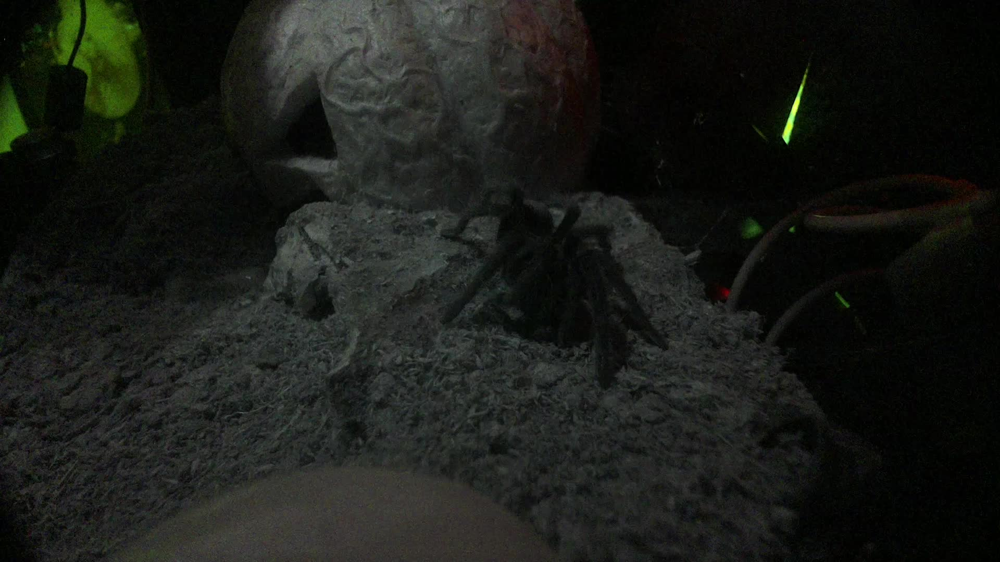
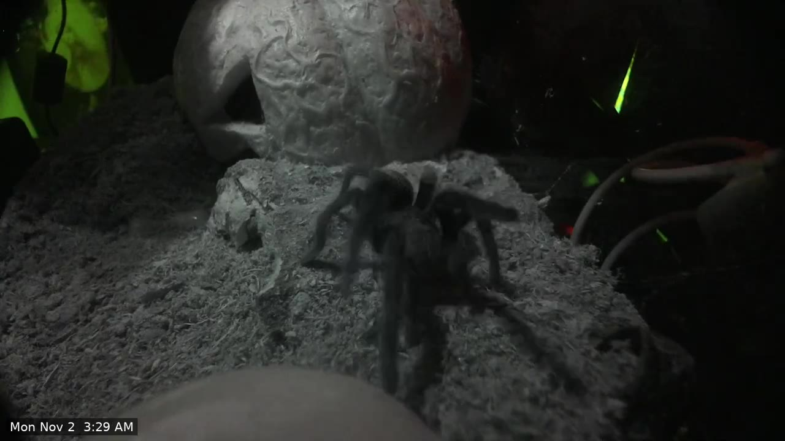
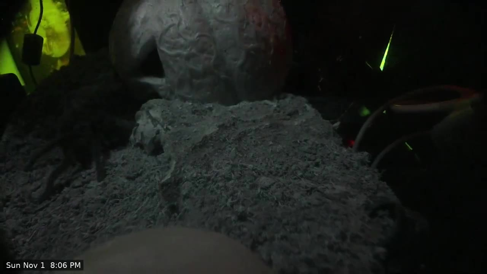
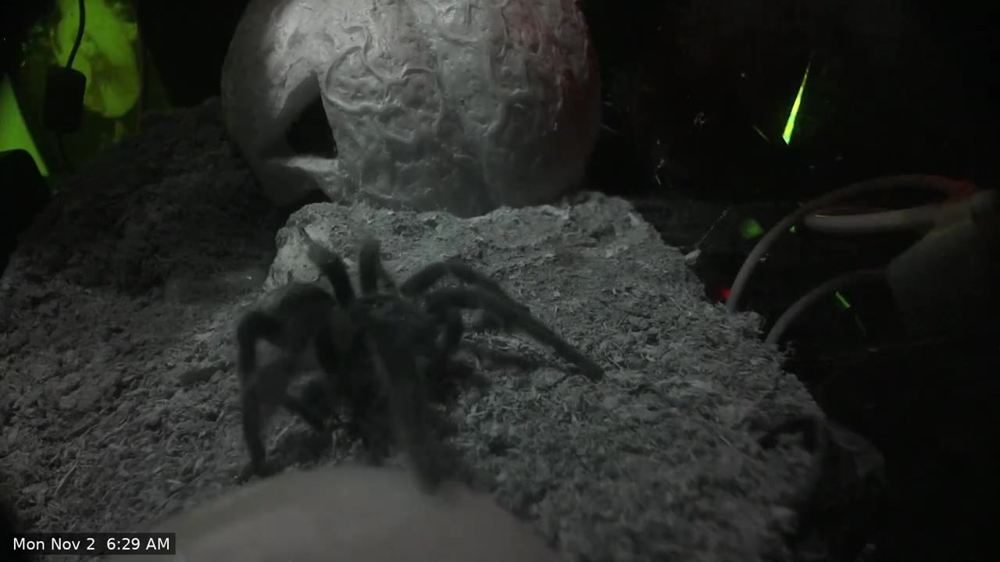
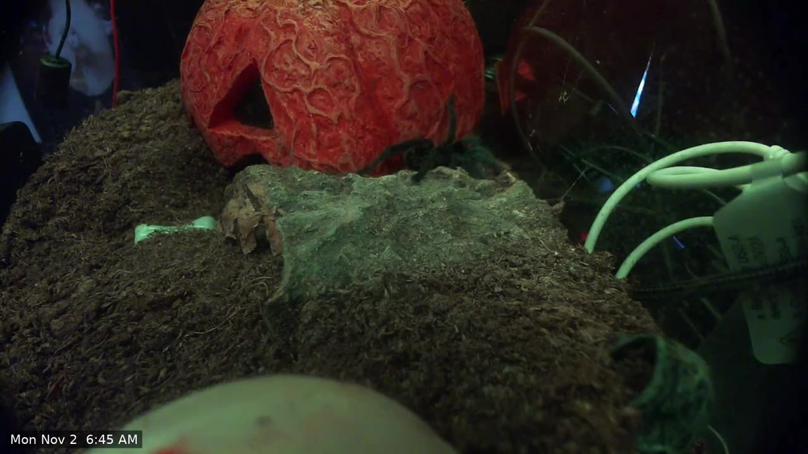
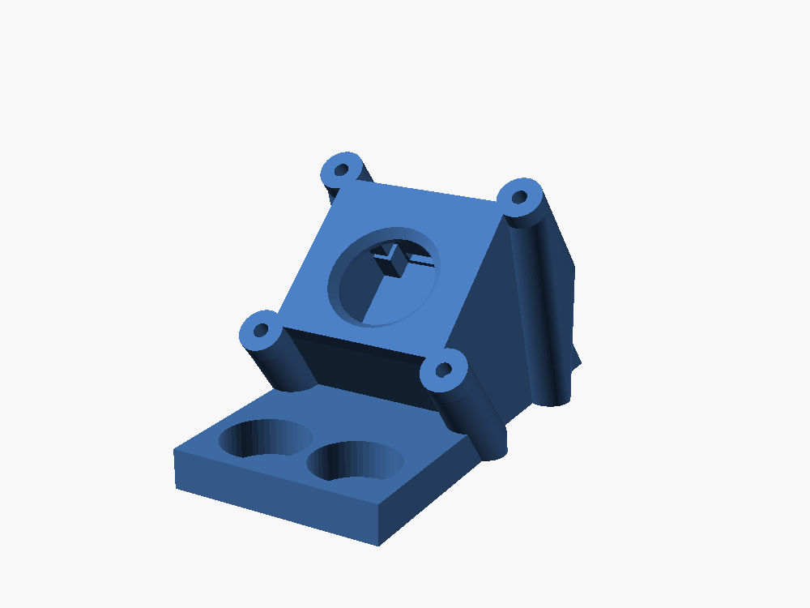

# Gallery

Stills and clips from the running cameras, and renders of the hardware.

To add one, put the image in `docs/assets/gallery/` named `YYYY-MM-DD-animal-note.jpg` and add an entry below.

## Stills

### Brazilian black tarantula, night

First still from the live camera at night: 1080p, continuous autofocus in macro range, lit by the 850 nm IR strip.

## From the nightly highlight reel

Frames from reels cut by the [highlight reel tool](highlight-reels). The clock time in the corner is added by the tool.

*Night view under IR light, a walk across the mound.*

*Night view, climbing toward the hide.*

*Close to the lens: continuous autofocus keeps the legs sharp.*

*Early morning under the enclosure's colour light, at the entrance of the hide.*

## Video

No clips posted yet.

## Hardware

*The v5 pod, rendered from the STL.*
