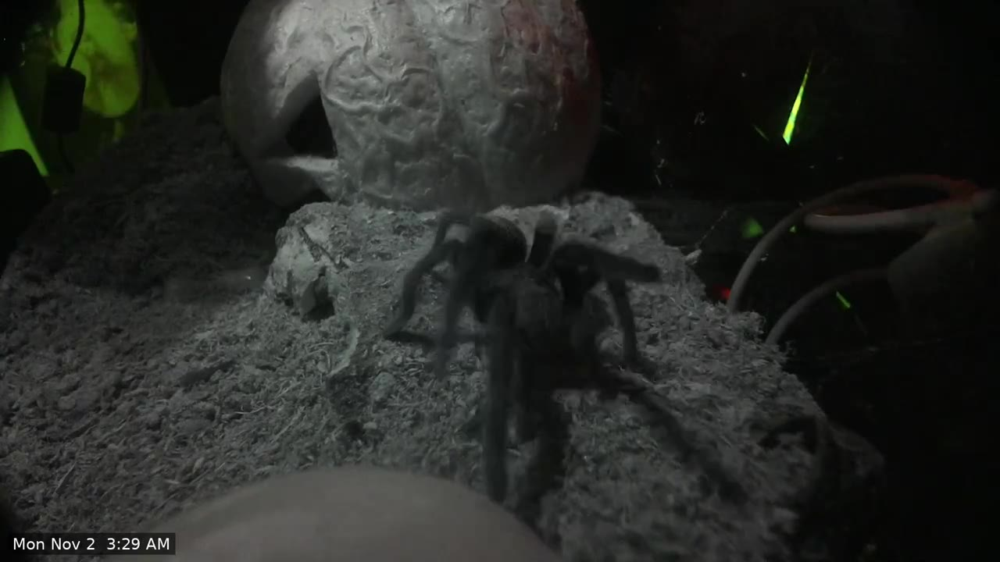

# Highlight reels

A nightly job that watches the day's recordings, keeps only the moments where the tarantula is in view,
and joins them into one short video with the clock time on every clip.


*A frame from a generated reel. The clock time in the corner is added by the tool.*

## Why

Motion recording on a quiet, dark scene is noisy. The enclosure lights fade between colours and the IR light
switches on and off, and each of those looks like movement to a motion detector. On the test day, roughly one in five
recorded motion events contained no animal at all. Scrolling a timeline to find the interesting minutes
is slow, so the reel does that part automatically.

## How it works

```
Frigate recordings (10 s segments, each with a motion score)
        |  group neighbouring active segments into events, take the 24 busiest
        v
sample one frame every 2 s from each event
        |  CLIP image model: "how likely is a tarantula in view?"
        v
keep the moments scoring 0.7 or higher (plus 4 s either side), drop empty events
        |  rank by share of frames with a spider x amount of motion, take the best 8
        v
cut, add the clock time, join  ->  reel.mp4 (plus a small 720p copy for sharing)
```

- **Event grouping.** Frigate stores recordings in 10-second segments and gives each a motion score. Active
  segments 30 seconds or less apart become one event.
- **Spider detection.** [CLIP](https://github.com/openai/CLIP) (`openai/clip-vit-large-patch14`) compares each
  frame to two descriptions of a tarantula and three of an empty enclosure. It needs no training. A score of
  0.8 or more meant a clearly visible spider, 0.5 to 0.8 was mixed, and below 0.5 was empty.
- **Full width.** CLIP resizes images to a square and crops the sides, which would hide an animal at the left or
  right edge of a 16:9 frame. The scorer instead looks at three full-height squares that cover the whole width
  and keeps the highest score.
- **Reel.** Events are limited to 60 seconds each, played in time order, and re-encoded at a constant 15 fps
  before joining.

## What it produces

| Output | Details |
|---|---|
| `PREFIX-YYYY-MM-DD.mp4` | Full-quality reel, about 2 to 5 minutes, one clip per event, clock time in the corner |
| `PREFIX-YYYY-MM-DD-share.mp4` | The same reel at 720p, about 9 MB for 4 minutes, small enough for chat apps |
| Notification | A message to your phone when the reel is ready, or when no tarantula was seen |
| Dashboard tab | Latest reel in a video player, download links, and the last 14 reels |

## Results

On a test day the tool examined 24 motion events:

- 19 contained the tarantula and went into the candidate pool. The best 8 made a 4 to 5 minute reel.
- 5 were dropped. The ones checked by eye were colour changes in the enclosure lighting with no animal.
- A full nightly run took about 90 seconds on an Intel Arc A380 (6 GB), including the first download of the model.

Known limits:

- A small spider tucked into the hide entrance can score near zero and be missed.
- Zooming into crops to find small spiders was tried and made things worse: close-ups of the substrate scored
  above 0.9 as "a hairy spider". The option exists (`--zoom`) and is off by default.
- The tool needs motion to look at. A spider that never moves is never recorded, so never scored.

## Requirements

- Frigate recording the camera on motion, with its API reachable (port 5000 without login, or through a proxy).
- Python 3.12 (the version it was tested with) with `torch`, `transformers` and `pillow`, and `ffmpeg` with the `drawtext` filter and
  a DejaVu font.
- A GPU is optional. The scorer uses CUDA, then Intel XPU, then falls back to CPU. On CPU it is slower (not measured). The model download is about 1.7 GB the first time.

## Run it by hand

From the `reels/` folder:

```bash
# list what would be picked, download nothing
python3 digest.py --camera mycam --scorer clip --hours 24 --dry-run

# build the reel
python3 digest.py --camera mycam --scorer clip --hours 24 --out reel.mp4
```

Set `FRIGATE_URL` if Frigate is not at `http://frigate:5000`. Use `--scorer motion` to skip the AI step and
just pick the busiest events.

| Option | Default | Meaning |
|---|---|---|
| `--hours` | 24 | How far back to look |
| `--top` | 8 | Clips in the reel |
| `--candidates` | 24 | Busiest events examined by the scorer |
| `--thresh` | 0.7 | Score that counts as "spider in view" |
| `--step` | 2 | Seconds between sampled frames |
| `--pad` | 4 | Seconds kept before and after the spider |
| `--max-len` | 60 | Longest clip, in seconds |
| `--min-motion` | 40 | Motion score for a segment to count as active |
| `--gap` | 30 | Quiet seconds that still keep one event together |

To look for a different animal, change the descriptions at the top of `scorer.py` (`POS` and `NEG`).

## Run it every night

`nightly.py` runs the digest at a set time, keeps the last 14 reels, creates the small share copy, serves
downloads and tells Home Assistant. It is meant to run in a container next to Frigate. It is configured with
environment variables:

| Variable | Default | Meaning |
|---|---|---|
| `CAMERA` | `camera` | Frigate camera name |
| `FRIGATE_URL` | `http://frigate:5000` | Frigate address |
| `REEL_PREFIX` | `reel` | File name prefix |
| `OUT_DIR` | `/reels` | Where reels are written |
| `RUN_AT` | `04:00` | Local time of the nightly run |
| `HOURS` | `24` | Look-back window |
| `KEEP_DAYS` | `14` | Reels older than this are deleted |
| `REEL_URL_BASE` | empty | Address that serves `OUT_DIR`, sent to Home Assistant with each reel |
| `HA_WEBHOOK_URL` | empty | Home Assistant webhook to notify |
| `DOWNLOAD_PORT` | `8088` | Port of the built-in download server |
| `RUN_NOW` | `0` | `1` runs once immediately at start |

**Tip:** Frigate serves everything under its `exports/` folder at `/exports/`. Writing reels to
`exports/reels/` therefore gives the dashboard a ready-made address to play them from.

The built-in download server only hands out files named `PREFIX-YYYY-MM-DD.mp4` and
`PREFIX-YYYY-MM-DD-share.mp4`, and it sends them as attachments so the browser saves them. It has no login,
so keep it on your home network.

On a GPU other than NVIDIA, use a PyTorch build for that GPU (for example the Intel XPU build) inside the
container and pass the render device through to it.

## Home Assistant

Two pieces connect the reels to the dashboard.

**1. A webhook automation** receives the container's message, records the date, and sends a phone notification.
Create an `input_text` helper named `reel_dates` (maximum length 255), then:


```yaml
alias: Highlight reel notification
triggers:
  - trigger: webhook
    webhook_id: your-secret-webhook-id
    allowed_methods: [POST]
    local_only: true
actions:
  - if:
      - condition: template
        value_template: "{{ trigger.json.date | default('') != '' }}"
    then:
      - action: input_text.set_value
        target:
          entity_id: input_text.reel_dates
        data:
          value: >
            
            {{ ((cur + [trigger.json.date]) | unique | sort)[-14:] | join(',') }}
  - action: notify.mobile_app_your_phone
    data:
      title: "{{ trigger.json.title }}"
      message: "{{ trigger.json.message }}"
mode: queued
```


Do not set an `initial` value on the helper, or its list is cleared every time Home Assistant restarts.
Use the webhook address `http://<home-assistant>:8123/api/webhook/your-secret-webhook-id` as `HA_WEBHOOK_URL`.

**2. A Reels view** on the camera dashboard. A markdown card plays the newest reel and links the rest:


```yaml
- title: Reels
  path: reels
  type: sections
  sections:
    - type: grid
      cards:
        - type: markdown
          content: >
            
            
            
            No reels yet.
            **Latest: {{ dates[0] }}**

            <video controls preload="metadata" width="100%" src="{{ play }}{{ dates[0] }}.mp4"></video>

            Download: [full quality]({{ dl }}{{ dates[0] }}.mp4) | [share size, 720p]({{ dl }}{{ dates[0] }}-share.mp4)
            
```


**Warning:** these links use plain `http`. If you open Home Assistant over `https`, the browser blocks the video.
Open it over `http` on your home network, or serve the reels over `https`.

## Files

| File | Purpose |
|---|---|
| `reels/digest.py` | Builds one reel: lists events, scores them, cuts and joins |
| `reels/scorer.py` | The CLIP scorer |
| `reels/nightly.py` | Scheduler, share copy, download server, Home Assistant webhook |

Next: [Gallery](gallery).
