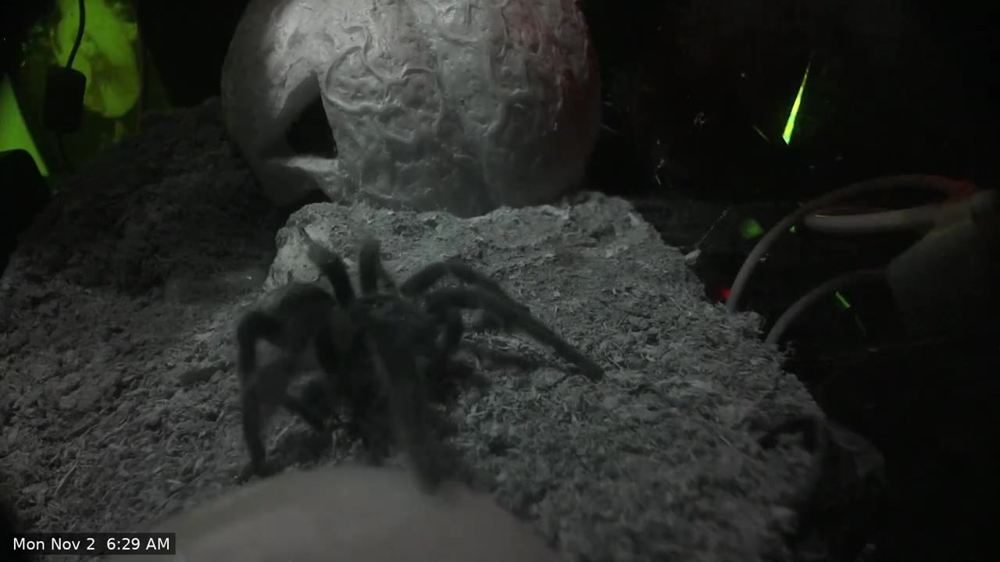

# creeperCam

Night-vision cameras for pet enclosures, built from a Raspberry Pi, a Camera Module 3 Wide NoIR and
3D-printed parts. The stream is recorded by Frigate and shown in Home Assistant, and a nightly job cuts
the day's recordings into a short reel of the moments the animal is in view. Everything is documented
here so you can build the same thing.

*A frame from a generated reel: continuous autofocus, lit by the 850 nm IR strip, clock time added by the tool.*

## What it does

- **Camera inside, computer outside.** Only a small printed pod with the camera sits in the humid
  enclosure. The Pi stays outside, joined by a ribbon cable.
- **Records only when something moves.** Frigate keeps motion-triggered recordings on a home server.
- **Home Assistant is the front end.** Live view, recordings, motion events, an IR light switch and the daily reels.
- **A reel every night.** An image model finds the moments where the tarantula is in view and joins them
  into one video with the time on each clip, plus a small copy that is easy to share.

## Status

| Piece | State |
|---|---|
| Camera and Pi streaming 1080p at 15 fps | Working. One camera is live in a Brazilian black tarantula enclosure. |
| Frigate recording and Home Assistant dashboard | Working. Motion-triggered, viewed with the Advanced Camera Card. |
| IR light | Working. A 12 V 850 nm LED strip on a Shelly dimmer, controlled from Home Assistant. |
| Nightly highlight reel | Working. Runs at 04:00 on the home server's GPU and sends a phone notification. |
| Printed pod (v5) | Designed. Earlier versions are test-printed; the final fit check is open. |
| Self-contained box (Pi and IR in one housing) | Draft, not printed. |
| Pods for the other two animals | Waiting on the first pod passing its tests. |

## Read in this order

1. [Hardware](hardware): the parts, why each was chosen, and measurements of the camera clone.
2. [Enclosures and printed parts](enclosures-and-stls): every STL, its dimensions, and how the design evolved.
3. [Software](software): the Pi, the stream, the web UI and autofocus tuning.
4. [Home Assistant and Frigate](home-assistant-frigate): recording, the dashboard and saving clips.
5. [Highlight reels](highlight-reels): the nightly job that finds the animal and cuts the reel.
6. [IR light](ir-light): the 850 nm illuminator, in use and as a home-built alternative.
7. [Build guide](build-guide): step by step, to replicate the whole thing.
8. [Parts list](bom): what to buy and roughly what it costs.
9. [Lessons learned](lessons-learned): what went wrong, so yours goes better.
10. [Gallery](gallery): stills from the live camera and from generated reels.

Source, STL files and OpenSCAD models are in the [repository]({{ site.github.repository_url }}).
